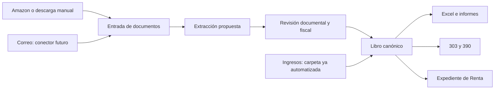

# Contabilidad modular de Kairo

Estado funcional del 17/11/2026. Esta guía sustituye los planes anteriores de
interfaz e ingesta; el estado de despliegue se acredita en la nota privada de
la entrega. Los documentos fiscales y la configuración quedan fuera de Git.

## Contratos y responsabilidades

| Módulo | Entrada | Salida estable | Implementación |
|---|---|---|---|
| Obtención | Pedido, descarga o adjunto | Original PDF y procedencia | Descarga manual disponible; acceso Amazon y conector de correo pendientes |
| Entrada Amazon | ZIP/PDF ya descargados | Originales por SHA256 y manifiesto documental versión 1 | `amazon_inbox.prepare`; transferencia manual con `amazon_transfer` hacia la bandeja existente |
| Entrada | Uno o varios PDF | Original inmutable, SHA256 y borrador | `ExpenseStore.upload`, bandeja con carga secuencial y resultado por archivo |
| Lectura | PDF y contrato | Propuesta versión 1, evidencia por campo | Texto básico; contrato IA en `expense_policy`; sin proveedor IA/OCR integrado |
| Revisión | Propuesta y decisión del usuario | Ficha fiscal versión 1 y paquete aprobado | `expense_policy`, `ExpenseStore.edit/approve/bundle` |
| Archivo y libro | Paquetes aprobados e ingresos existentes | Versión del libro, originales y recibos de operación | `expense_workflow`, `income_refresh`, `sync_models` |
| Salidas | Una versión verificada | Excel de consulta, informes, preparación 303/390 | `accounting_workbook`, `review_year`, exportadores existentes |
| Interfaz | Lectura y comandos autenticados | Resumen, bandeja, ingresos, libros, modelos y documentos de Renta | `accounting_views`, `modelos_web`, `vat_dashboard` |

La interfaz no mantiene un segundo libro ni calcula impuestos por su cuenta.
El JSON privado es la fuente canónica; Excel es una salida regenerable.
Las rutas de ingresos, originales históricos y publicador de facturas existentes
se conservan. No se duplican sus procesos.

## Decisiones de gasto

La ficha conserva `expense_policy_version=1`, `category`, `tax_scope`,
`irpf_treatment`, `business_purpose`, `buyer_tax_id`, `invoice_status`,
`order_reference` y `buyer_identity_confirmed`, además de la identificación,
fechas e importes originales. El paquete de incorporación mantiene versión 1
con estos campos adicionales del registro; los paquetes históricos sin ficha
conservan su contenido y huellas.

- `iva_irpf`: inclusión en el cálculo IVA admitido; exige documento completo,
  destinatario cotejado, uso profesional descrito y confirmación fiscal.
  El nombre del destino no acredita deducción IRPF.
- `irpf_only`: archivo para revisar en Renta, con `include=false` en IVA.
- `review`: pendiente de criterio, fuera del cálculo de IVA.
- `excluded`: exclusión documentada de ambos circuitos.

La clasificación IRPF `pending/current_expense/asset/excluded` no calcula una
deducción, porcentaje de afectación ni amortización. Electricidad y gas quedan
fuera del IVA por preferencia expresa del usuario, no como afirmación fiscal
universal. Telefonía/internet no obtienen deducción automática por categoría.
La validación también se aplica en el motor, no solo en la pantalla.

## Proveedor y Amazon

Registrar el proveedor que corresponda al documento. El fabricante, la marca,
el transportista y la plataforma no determinan por sí solos el emisor fiscal.
Amazon puede emitir por cuenta de un vendedor; no sustituir su identidad por
una razón social o NIF genéricos. Mantener separado el supuesto en que Amazon
sea el proveedor o tenga otro papel fiscal acreditado por la documentación.

Fuentes consultadas el 17/11/2026:
- [AEAT: facturas expedidas por terceros](https://sede.agenciatributaria.gob.es/Sede/iva/facturacion-registro/facturacion-iva/facturas-expedidas-destinatario-terceros.html).
- [AEAT: contenido de las facturas](https://sede.agenciatributaria.gob.es/Sede/iva/facturacion-registro/facturacion-iva/contenido-facturas.html).
- [Amazon: servicio de cálculo del IVA y emisión por cuenta del vendedor](https://sellercentral.amazon.es/help/hub/reference/external/GH3ZSPRW2VTSD57S).

La bandeja ofrece un texto revisable para solicitar una factura completa o
corregida. No lo envía ni marca una solicitud como enviada. El futuro conector
debe comprobar primero si la factura adecuada ya existe y evitar peticiones
duplicadas por pedido/vendedor. Descargar y solicitar son acciones diferentes.
Requiere acceso a la cuenta correspondiente; no crear cuentas ni cambiar
suscripciones como parte de una descarga.

Amazon Business ofrece descarga masiva de documentos desde Análisis de empresa.
El módulo de entrada recibe el ZIP o los PDF obtenidos y conserva originales y
procedencia en `ENTRADA/AMAZON`, sin mover `FACTURAS/año/FACTURAS AMAZON`.
Se activa manualmente; no vigila la carpeta Descargas ni realiza lecturas periódicas.
El transporte reutiliza la conexión SSH privada de Modelos. La cola de revisión
continúa siendo la de Kairo, sin crear una segunda cola en el mini.

Las facturas desconocidas entran como borradores y requieren revisión documental:
un PDF descargado puede ser un resumen de pedido y no acreditar una factura.
Los abonos identificados se conservan para revisión específica, fuera de la cola
de aprobación de gastos ordinarios. Una descarga o una importación no acredita
deducibilidad ni cobertura del trimestre. La API oficial de documentos de comprador
para España requiere aprobación y credenciales de Amazon; no está habilitada por
instalar este importador. Ver instrucciones de ejecución en `tools/iva/README.md`.

## Correo y Renta

El futuro conector de correo entregará el mismo original y manifiesto de entrada:
ID de mensaje/adjunto, emisor, fecha de recepción, SHA256 y origen. Recopilará
proveedores seleccionados, no todo el correo. No asignará deducibilidad por
remitente. Luz/gas se proponen para Renta y su IVA permanece documental.
Un adjunto reenviado no debe convertirse en una segunda factura.

## Ejecución y criterio de entrega

Sin comprobaciones periódicas: subir, guardar una propuesta o consultar no
actualiza el archivo. Aprobar, aportar un justificante nuevo o pulsar Actualizar
datos solicita el trabajo. La carga por lotes es una acción manual; los errores
por archivo no cancelan los documentos válidos. No hay aprobación en bloque
implícita ni se interpretan las propuestas IA como autorización fiscal.

La incorporación y publicación se confirman cuando libro y salidas se han
verificado. Si falla, se conserva la última copia con su fecha. El Excel actual
debe llevar la misma huella de libro que el índice; los anteriores se identifican
como archivos históricos. Las confirmaciones de cobertura, presentación y pago
siguen separadas.

Siguiente entrega: verificar el acceso y la descarga real en la cuenta Amazon,
entrada asistida por IA utilizando el contrato existente y recopilación desde correo.
Amortizaciones y cálculo IRPF requieren su módulo propio; no bloquean el archivo
de documentos pendientes. No reabrir todos los ensayos históricos para cada cambio.
