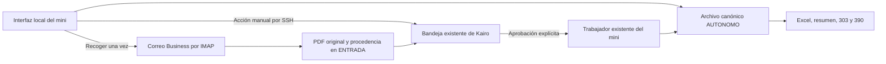

# Contabilidad en el mini

Aplicación local para Windows, iniciada desde **Kairo Contabilidad** en el
escritorio. La interfaz se sirve en `127.0.0.1:18766`, con sesión local privada.
No hay publicación web, acceso por LAN, tarea programada ni recogida periódica.
El proceso queda esperando peticiones HTTP; no consulta fuentes en reposo.

## Uso

- **Resumen, Ingresos y Gastos:** consulta del libro existente, filtro por
  trimestre y búsqueda; acceso a los originales verificados.
- **Libros:** descarga del Excel de la misma versión y archivos históricos.
- **Modelos:** consulta de 303/390, preparación y archivo de justificantes con
  los controles fiscales existentes. No firma ni presenta declaraciones.
- **Renta:** documentos separados del IVA; no calcula la declaración de IRPF.
- **Recoger facturas:** una consulta al correo Business para el pedido confirmado
  configurado. Conserva los adjuntos en el mini y los envía como borradores a
  la bandeja existente. Si solo hay un enlace o aún no hay PDF, lo indica.
- **Añadir PDF:** carga manual de cualquier proveedor. Conserva el PDF local
  antes de transmitirlo; detecta documentos del libro y de la bandeja.
- **Actualizar datos:** solicita una ejecución al trabajador de Modelos ya
  instalado. **Ver estado** consulta su resultado una sola vez; recargar la vista
  lee la versión disponible, sin lanzar otra actualización.
- **Cómo funciona** (`/ayuda`): guía integrada con el recorrido de un gasto,
  significado de cada botón y estado, conexiones necesarias y alcance pendiente.
  Se puede consultar al volver a abrir el acceso directo, sin depender del chat.

La recogida no aprueba la clasificación fiscal, los importes ni la identidad del
proveedor. El correo no se marca como leído. No abre Chromium, no usa una API de
comprador de Amazon ni requiere que Codex esté abierto.

La vista local de Modelos muestra una tarjeta breve por periodo: estado, importe
cuando está disponible y acción principal. La cobertura, los avisos y los pasos
pendientes siguen accesibles en un desplegable. Este modo compacto no cambia
los cálculos ni la presentación de la interfaz remota.

El tema, los estilos y los iconos se incluyen en el HTML inicial para evitar
destellos al navegar. El logotipo usa la forma oficial como máscara transparente,
con el color de acento de cada tema. No depende de una descarga posterior de
la imagen para mostrar el encabezado.

## Módulos y contratos



`desktop_app` sirve la interfaz y aplica sesión, Host, Origin y CSRF.
`desktop_transport` envía peticiones limitadas por SSH, reutilizando la clave
configurada. `desktop_remote` se ejecuta solo para esa petición y llama a los
motores ya instalados; no modifica el servicio remoto. Sus escrituras respetan
el mismo `service.lock` que la interfaz de Kairo.

`desktop_intake` conserva los originales y la procedencia antes del transporte.
Usa el manifiesto Amazon versión 1 y el importador existentes. Los documentos
recogidos son `source_kind=unknown` y deben revisarse. Un error conserva el PDF
para repetir manualmente sin perderlo ni duplicarlo. Los abonos necesitan revisión
específica; no existe clasificación fiscal automática por remitente.

La lectura del correo reutiliza la cuenta y contraseña de aplicación que ya
usa el servicio de facturas. La contraseña permanece en el equipo que la guarda;
no se copia al mini, a Git, al navegador ni a los registros. Gmail se abre en modo
solo lectura, buscando el número exacto de pedido en Todo el correo (INBOX como
alternativa explícitamente limitada). Máximo 20 mensajes, 10 PDF y 8 MiB por PDF.
No sigue enlaces del correo. Solo admite candidatos de `amazon.es` y subdominios;
esto selecciona documentos, no acredita su autenticidad fiscal.

## Instalación y recuperación

Requiere el entorno de Modelos instalado, Python y sus dependencias existentes,
`config.json`, `amazon-manual.json` y acceso SSH. Desde el checkout:

```powershell
& .\tools\iva\install-desktop.ps1
& "$env:LOCALAPPDATA\GestifyFacturacion\modelos\launch-desktop.ps1"
```

El instalador conserva la configuración privada existente. En la primera
instalación obtiene pedido y cuenta de `amazon-manual.json`. El puerto se puede
indicar con `-Port`; debe estar libre. No modifica la generación de ingresos,
el listener de acciones ni la aplicación móvil.

Una reinstalación para únicamente el proceso `desktop_app.py` identificado por
PID y ruta, copia los módulos y conserva un respaldo privado de los anteriores.
Debe hacerse sin acciones en curso. El acceso directo inicia el servidor o
reutiliza la instancia autenticada que ya está abierta. Un puerto ocupado por
otro programa se rechaza. El token de arranque se guarda en el estado privado,
nunca en el acceso directo ni en Git.

## Alcance actual

Resumen, tablas, originales y libros se consultan desde el archivo del mini sin
conectar a Kairo. La bandeja, preparación fiscal, actualización y recogida de
correo requieren la conexión privada al equipo que ya tiene esos módulos.
No hay un segundo libro ni una segunda bandeja.

Esta entrega configura la recogida del pedido de prueba seleccionado, no una
descarga de todo el historial de Amazon. Siguen pendientes la extracción avanzada
IA/OCR, la recogida de otros proveedores y el cálculo completo de Renta. La interfaz
móvil no se despliega ni modifica en esta entrega.

Validación: pruebas `test_desktop` y `test_vat_dashboard`; revisión visual local
en claro/oscuro y ancho estrecho; comprobación real de correo sin factura disponible.
