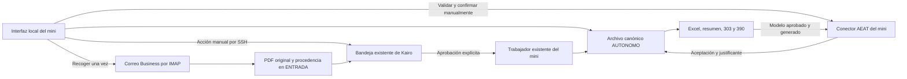

# Contabilidad en el mini

Desde el 18/11/2026, el trabajo de Kairo continúa en el repositorio
`C:/Users/Angel/proyectos_claude/kairo`. El commit inicial de la separación
es `b57cd96`. Su README localiza el código del mini, la web móvil y los
módulos compartidos. Esta guía conserva el historial anterior. Gestify
mantiene su propio repositorio y su lado del puente con Kairo.

Aplicación local para Windows, iniciada desde **Kairo Contabilidad** en el
escritorio. La interfaz se sirve en `127.0.0.1:18766`, con sesión local privada.
No hay publicación web, acceso por LAN, tarea programada ni recogida periódica.
El proceso queda esperando peticiones HTTP; no consulta fuentes en reposo.

## Uso

- **Facturas:** catálogo, histórico, PDF y revisión mensual de los servicios
  existentes. Permite aprobar/cancelar la programación de una factura preparada.
  No añade una emisión inmediata: respeta las horas y condiciones del motor actual.
- **Programación:** calendario compartido de correos y facturas, navegación mensual
  y consulta explícita de Outlook mediante «Actualizar». Al abrir se leen los
  estados guardados. Los correos se siguen preparando y programando desde Gestify;
  Kairo ofrece su consulta, sin otro editor de programación.
- **Resumen, Ingresos y Gastos:** consulta del libro existente, filtro por
  trimestre y búsqueda; acceso a los originales verificados.
- **Libros:** descarga del Excel de la misma versión y archivos históricos.
- **Modelos:** consulta y preparación de 303/390, validación oficial y presentación
  manual desde el mini con el certificado de Windows. Requiere una versión aprobada,
  periodo completo y confirmación final; genera y conserva su evidencia. Véase
  [el recorrido AEAT y sus comprobaciones pendientes](IVA-AEAT.md).
- **Renta:** documentos separados del IVA; no calcula la declaración de IRPF.
- **Recoger facturas:** una consulta al correo Business para el pedido confirmado
  configurado. Conserva los adjuntos en el mini y los envía como borradores a
  la bandeja existente. Si solo hay un enlace o aún no hay PDF, lo indica.
- **Añadir PDF:** carga manual de cualquier proveedor. Conserva el PDF local
  antes de transmitirlo; detecta documentos del libro y de la bandeja.
- **Actualizar datos:** solicita una ejecución al trabajador de Modelos ya
  instalado. **Ver estado** consulta su resultado una sola vez; recargar la vista
  lee la versión disponible, sin lanzar otra actualización.
- **Cómo funciona** (`/ayuda`): guía integrada con el recorrido de un gasto,
  significado de cada botón y estado, conexiones necesarias y alcance pendiente.
  Se puede consultar al volver a abrir el acceso directo, sin depender del chat.

La recogida no aprueba la clasificación fiscal, los importes ni la identidad del
proveedor. El correo no se marca como leído. No abre Chromium, no usa una API de
comprador de Amazon ni requiere que Codex esté abierto.

La vista local de Modelos muestra una tarjeta breve por periodo: estado, importe
cuando está disponible y acción principal. La cobertura, los avisos y los pasos
pendientes siguen accesibles en un desplegable. Este modo compacto no cambia
los cálculos ni la presentación de la interfaz remota.

El tema, los estilos y los iconos se incluyen en el HTML inicial para evitar
destellos al navegar. El logotipo usa la forma oficial como máscara transparente,
con el color de acento de cada tema. No depende de una descarga posterior de
la imagen para mostrar el encabezado.

## Módulos y contratos



`desktop_app` sirve la interfaz y aplica sesión, Host, Origin y CSRF.
`desktop_transport` envía peticiones limitadas por SSH, reutilizando la clave
configurada. `desktop_remote` se ejecuta solo para esa petición y llama a los
motores ya instalados; no modifica el servicio remoto. Sus escrituras respetan
el mismo `service.lock` que la interfaz de Kairo.

`desktop_intake` conserva los originales y la procedencia antes del transporte.
Usa el manifiesto Amazon versión 1 y el importador existentes. Los documentos
recogidos son `source_kind=unknown` y deben revisarse. Un error conserva el PDF
para repetir manualmente sin perderlo ni duplicarlo. Los abonos necesitan revisión
específica; no existe clasificación fiscal automática por remitente.

`desktop_billing` es el adaptador de Facturas y Programación. Viaja como código
de esta instalación en la petición SSH y llama únicamente a rutas permitidas de
los dos servicios HTTP locales existentes en Kairo. Conserva sus bloqueos, trabajos,
identidades de plan y huellas de aprobación. El navegador usa la sesión/CSRF del
mini; el token del servicio remoto se obtiene y utiliza solo dentro del adaptador.
No instala otro servicio, abre puertos de red ni inicia los emisores.

El HTML se incorpora al marco local, conservando diálogos y controles propios
de cada módulo. Sus estilos quedan acotados para mantener el tema del escritorio.
La importación de un borrador mantiene el comportamiento del servicio existente,
incluido el posible aviso de revisión al propietario si está configurado. No se
ejecutan envíos reales para comprobar la integración.

Gestify permanece externo: envía preparaciones y consulta estados por su botón
de sincronización, y conserva la preparación y programación de correos. La aplicación
no controla Gestify ni crea un segundo editor de esos correos. Véase el alcance
completo en [KAIRO-ECOSYSTEM.md](KAIRO-ECOSYSTEM.md).

`aeat_workflow` añade el circuito local de presentación; `aeat_submission` conserva
sus operaciones y `aeat_windows` utiliza el certificado del almacén de Windows sin
exportar la clave. «Validar modelo» y «Firmar y presentar en Hacienda» son acciones
distintas. «Consultar resultado / recuperar justificante» nunca reenvía un intento
incierto. Los modelos, respuestas y justificantes aceptados se archivan en AUTONOMO.
No se modifica la instalación emisora de facturas ni su certificado de VeriFactu.
Windows puede pedir permiso para usar la clave en su ventana protegida; se conserva
esa protección. Una petición caducada requiere otra acción manual, no un reintento
automático de presentación.

La lectura del correo reutiliza la cuenta y contraseña de aplicación que ya
usa el servicio de facturas. La contraseña permanece en el equipo que la guarda;
no se copia al mini, a Git, al navegador ni a los registros. Gmail se abre en modo
solo lectura, buscando el número exacto de pedido en Todo el correo (INBOX como
alternativa explícitamente limitada). Máximo 20 mensajes, 10 PDF y 8 MiB por PDF.
No sigue enlaces del correo. Solo admite candidatos de `amazon.es` y subdominios;
esto selecciona documentos, no acredita su autenticidad fiscal.

## Instalación y recuperación

Requiere el entorno de Modelos instalado, Python y sus dependencias existentes,
`config.json`, `amazon-manual.json` y acceso SSH. Desde el checkout:

```powershell
& .\tools\iva\install-desktop.ps1
& "$env:LOCALAPPDATA\GestifyFacturacion\modelos\launch-desktop.ps1"
```

El instalador conserva la configuración privada existente. En la primera
instalación obtiene pedido y cuenta de `amazon-manual.json`. El puerto se puede
indicar con `-Port`; debe estar libre. No modifica la generación de ingresos,
el listener de acciones ni la aplicación móvil.

Una reinstalación para únicamente el proceso `desktop_app.py` identificado por
PID y ruta, copia los módulos y conserva un respaldo privado de los anteriores.
Debe hacerse sin acciones en curso. El acceso directo inicia el servidor o
reutiliza la instancia autenticada que ya está abierta. Un puerto ocupado por
otro programa se rechaza. El token de arranque se guarda en el estado privado,
nunca en el acceso directo ni en Git.

## Alcance actual

Resumen, tablas, originales y libros se consultan desde el archivo del mini sin
conectar a Kairo. La bandeja, preparación fiscal, actualización y recogida de
correo requieren la conexión privada al equipo que ya tiene esos módulos.
No hay un segundo libro ni una segunda bandeja.

La presentación AEAT se ejecuta en el mini y requiere Internet, certificado vigente
y acceso a la preparación de Kairo. El 4T real sigue incompleto; no se habilita su
presentación por tener instalada la conexión. Hay validación oficial con datos
sintéticos y del fichero histórico 303 2T 2026 (sin errores, aviso 31190), pero no
una presentación real probada con este conector. La consulta autenticada del 303
3T 2026 se completó el 17/11/2026 a las 19:02:50 UTC y encontró una declaración,
sin crear otra. NIF, CSV, justificante y fecha/hora coinciden con el PDF histórico
archivado. La descarga directa del justificante no está comprobada: esa
consulta no proporciona una URL. Esta capacidad
local todavía no implica paridad de presentación desde el móvil.

Esta entrega configura la recogida del pedido de prueba seleccionado, no una
descarga de todo el historial de Amazon. Siguen pendientes la extracción avanzada
IA/OCR, la recogida de otros proveedores y el cálculo completo de Renta. La interfaz
móvil no se despliega ni modifica en esta entrega.

Validación: pruebas `test_desktop`, `test_desktop_billing` y `test_vat_dashboard`; revisión visual local
en claro/oscuro y ancho estrecho; comprobación real de correo sin factura disponible.

## Encargos a la IA y carpeta de entrada

En **Recoger facturas** se puede crear un encargo de correo (Amazon, Digi,
electricidad, gas u otro proveedor, cuenta y fechas) o de revisión de PDF ya
depositados. Crear el encargo guarda su ID y alcance en
`state_root/assistant-requests`, fuera de Git. La cuenta se introduce libremente
o se elige entre las sugerencias de la configuración privada; el código no
incluye direcciones personales. Las fechas son criterios de búsqueda, nunca una
declaración de cobertura contable del mes o trimestre.

**Copiar prompt** prepara texto para un asistente con los accesos necesarios.
**Abrir en ChatGPT** usa el enlace de escritorio documentado
`codex://new?prompt=...&path=...`: coloca el encargo en el compositor y el usuario
lo envía. No envía mensajes automáticamente ni utiliza una API de IA. Si la
aplicación no maneja el enlace, se puede copiar el texto. El acceso al correo y
al mini debe existir en el asistente elegido; abrir ChatGPT no lo concede.
[Referencia del enlace de escritorio](https://learn.chatgpt.com/docs/reference/commands.md).

**Abrir carpeta de entrada**, disponible también en Gastos, abre el Explorador
en `AUTONOMO/ENTRADA/GASTOS/2026`. La carpeta se crea solo mediante una acción
manual. Depositar archivos no activa nada. **Importar PDF depositados** recorre
una vez los PDF de esa carpeta (sin subcarpetas), admite hasta 100 documentos de
8 MiB cada uno y rechaza enlaces, rutas externas y PDF inválidos. Cada archivo
conserva su resultado; una incidencia no descarta los demás. El libro verificado
y la bandeja única existente permiten evitar una segunda alta por SHA256.
La recogida directa del pedido Amazon configurado sigue disponible en un
desplegable separado y mantiene su alcance anterior.

El asistente puede devolver un informe privado con este contrato:

```json
{
  "schema_version": 1,
  "request_id": "ID_DEL_ENCARGO",
  "documents": [{
    "path": "ENTRADA/GASTOS/2026/documento.pdf",
    "sha256": "HUELLA_REAL_DEL_ORIGINAL",
    "source": {"kind": "email", "provider": "Proveedor", "message_id": "ID_REAL"}
  }],
  "pending": ["Incidencias concretas o documentos todavía no localizados"]
}
```

`source.kind` admite `email`, `download`, `manual_folder` u `other`; los demás
campos opcionales son `provider`, `account`, `message_id`, `attachment_id`,
`received_at`, `url` HTTPS y `note`. Se omiten los datos desconocidos. El prompt
incluye el intérprete, script y configuración locales para registrar el informe:

```powershell
python RUTA_INSTALADA/assistant_requests.py --settings DESKTOP_CONFIG_PRIVADA.json --request ID_DEL_ENCARGO --report INFORME_PRIVADO.json
```

Para procesar los PDF, el prompt pide leer todas las páginas y extraer emisor
fiscal real, NIF, número, fecha e importes documentales. Cada elemento de
`documents` admite además `proposal`, con el contrato de `expense_policy`:

```json
{
  "schema_version": 1,
  "document_sha256": "LA_MISMA_HUELLA_DEL_PDF",
  "values": {"number": "NUMERO_LEIDO", "base": "18.00"},
  "evidence": {
    "number": [{"page": 1, "quote": "Cita literal del número"}],
    "base": [{"page": 1, "quote": "Cita literal de la base"}]
  }
}
```

Se valida el SHA, la existencia de cada página y la evidencia de cada campo.
Las citas siguen siendo propuestas que el usuario debe cotejar. No se aceptan
tratamientos fiscales, inclusión ni confirmaciones en ese contrato. La CLI solo
registra el informe. Al importar manualmente, la propuesta se aplica únicamente
a un borrador recién creado, con su revisión exacta; un duplicado conserva su
revisión. Si falla la propuesta después de guardar el PDF, se informa por separado
y el documento permanece en la bandeja. El comando copiable utiliza `python.exe`
cuando la aplicación local se ejecuta mediante `pythonw.exe`.

El registro verifica ruta, PDF y huella antes de aceptar la procedencia. Conserva
los eventos e informes anteriores. Un informe posterior actualiza sus pendientes
declarados, sin borrar el historial. En encargos de correo, la importación acepta
solo los documentos declarados y con su SHA original; un reemplazo se señala como
incidencia. En encargos de carpeta se recoge el contenido de la acción manual y
también se exige el SHA original de los archivos previamente declarados.

**Comprobar resultados** consulta una vez el libro local verificado y la bandeja:
«PDF recuperado» acredita el original local; «En revisión» acredita el documento
en la bandeja; «Incorporado al libro» requiere registro y original coincidentes
por SHA256. Subir un PDF o recibir un informe no acredita incorporación. Los
errores de consulta se muestran y no se convierten en comprobaciones superadas.
Ninguna de estas acciones aprueba gastos, solicita una actualización fiscal,
envía correos ni presenta modelos. No hay temporizadores ni sondeos.

El módulo `assistant_requests` gestiona registros, importación y conciliación.
`desktop_app` expone las acciones bajo las mismas guardas de sesión, Host, Origin
y CSRF. GET solo lee registros guardados; crear, abrir carpeta, importar y
conciliar son POST explícitos. La CLI escribe únicamente el informe del encargo.

## Revisión de interfaz del 18 de noviembre de 2026

- Resumen ofrece 1T–4T y Año. Ingresos identifica el cliente a la izquierda y
  muestra días × tarifa y fórmulas; los desgloses proceden del PDF, no de dividir
  el importe. `document_details.py` adjunta metadatos de consulta por SHA, sin
  cambiar el JSON fiscal. Un PDF con varias facturas requiere además identidad
  por número de factura y evidencia específica; no recibe un concepto común.
- Gastos y Libros muestran conceptos documentados. Si falta descripción,
  aparece «Concepto pendiente de revisar»; nunca se sustituye por el nombre
  del archivo. Procedencia y citas quedan en Detalle, que conserva los anchos.
- Mis carpetas de 2026 abre FACTURAS/2026. La entrada sigue siendo una bandeja
  separada para documentos nuevos; no se han movido ni borrado originales.
- Importar termina en un resultado por PDF con el siguiente paso de revisión.
  Encargos permite fechas opcionales y atajos por trimestre, y ofrece volver.
- El histórico de facturas agrupa los meses de cada año. El detalle muestra el
  PDF verificado y su programación. En el mini, los envíos históricos enlazan
  a los originales incorporados al libro; una evidencia de envío por sí sola
  no acredita que el PDF esté disponible.
- El libro del 3T es un corte histórico. Las versiones CONSULTA son salidas del
  mismo libro; no se vuelven a rellenar ni se suman unas con otras.

Verificación: 73 pruebas focalizadas, una omitida por permisos de enlaces.
Vistas principales de Programación, Resumen, Ingresos, Gastos, importación y
facturas revisadas; PDF histórico y emitido visibles dentro de la pantalla.
La revisión adicional de todos los estados oscuros/estrechos quedó interrumpida
por desconexión del navegador. El Excel actualizado fue renderizado y revisado.

## Referencia para continuar con Claude u otro agente

Esta referencia identifica el código y el trabajo pendiente; no autoriza a
implementar automáticamente toda la lista visual de la sección siguiente.

Para retomar con Claude en el mini, abrir como espacio de trabajo
`C:/Users/Angel/Configuración ordenador mini codex`. Esa carpeta superior no es
por sí misma un repositorio. Según la pantalla, usar el checkout de contabilidad
o el repositorio Kairo Casa que figuran a continuación; no empezar a modificar
la copia instalada en AppData.

### Dos repositorios y una instalación

| Parte | Fuente que se debe editar | Referencia y destino |
| --- | --- | --- |
| Aplicación del mini, contabilidad y adaptadores | `tools/iva/` de este repositorio | [GitHub: horas-excelia, rama trabajo/libro-anual-iva](https://github.com/avi-work-projects/horas-excelia/tree/trabajo/libro-anual-iva). Checkout del mini: `C:/Users/Angel/proyectos_claude/worktrees/kairo-pruebas-pdf`. |
| Histórico y detalle de facturas | `tools/kairo/invoice_dashboard.py` de este repositorio | Se instala en el servicio existente `/home/angel/gestify-facturacion`. No sustituir sus otros módulos por copias antiguas del repositorio. |
| Programación compartida entre móvil y mini | `ui-horas/hours_receiver.html`, `ui-horas/hours_receiver.js`, `ui-horas/mail_calendar_view.js` del repositorio local Kairo Casa | `C:/Users/Angel/Configuración ordenador mini codex/setup-kvm/kairo-casa`. Rama observada: `trabajo/iconos-programacion`. No tiene remoto configurado. Destino: `/home/angel/gestify-outlook/tools`. |
| Portada, cabecera y estilos compartidos de Kairo | `web/` y `ui-facturas/` de Kairo Casa | Seguir `CLAUDE.md`, `INTERFAZ-KAIRO.txt` y los scripts de ese repositorio. |
| Gestify en el móvil | Aplicación `js/`, `css/` y recursos de horas-excelia | Es una interfaz distinta que entrega preparaciones y consulta estados. Cambiar la vista de Programación servida por Kairo no implica publicar Gestify. |
| Copia ejecutable del mini | `%LOCALAPPDATA%/GestifyFacturacion/modelos/code` | Es una instalación, no el checkout. Se actualiza con `tools/iva/install-desktop.ps1`; no editar aquí como única fuente. |

Hitos de esta rama de horas-excelia:

- `8af4cba`: conexión AEAT y resultado comprobado de la consulta existente.
- `2ccfacb`: preparación de IVA 2026 y encargos manuales de facturas a la IA.
- `b69d0a4`: tablas, conceptos, navegación y consulta visual de facturas;
  punto de control WIP porque quedaban comprobaciones visuales de tamaños/temas.

Antes de continuar, comprobar `git status`, rama, remoto y `git log` en **cada**
repositorio. `git fetch` del repositorio de GitHub no recupera Kairo Casa. El
HEAD observado de Kairo Casa al hacer esta auditoría era `ce8bd65`; los tres
archivos de Programación ya estaban rastreados. Se guardaron en el commit local
`1568913` de `trabajo/iconos-programacion`, sin cambiar su contenido instalado.
Este commit no está en GitHub: Kairo Casa no tiene remoto. Hay cambios ajenos en otros archivos: no incluirlos en un
commit general. No se ha creado una segunda copia de `ui-horas` en `tools/kairo`.

El 18/11/2026 se comprobó que las tres fuentes locales de Programación coinciden
byte a byte con las instaladas en Kairo. Huellas de esa comprobación:

| Archivo | SHA256 |
| --- | --- |
| `hours_receiver.html` | `724aab83533b98153d1379a29e9483463b2bf98df88110f0b4eaaa6f93beadd1` |
| `hours_receiver.js` | `d00a1e76ea7b4cdf33ae94e2e1783ecb83c902be91098b07b44a3a4e59f9cea7` |
| `mail_calendar_view.js` | `3416dba756a29a06798db85d01292294f4567f134a24fd82668bccaf8aafb056` |

Los tres archivos funcionan juntos: la plantilla recibe configuración del
servicio de horas, `hours_receiver.js` aporta el calendario y los iconos, y
`mail_calendar_view.js` compone la vista mensual y la actualización explícita.
Dependen del servicio existente de horas y de la cabecera/tema compartidos;
copiarlos por separado a otro repositorio no constituye una instalación completa.
En el mini, `desktop_billing.py` incorpora esa vista mediante el puente existente
y acota el CSS con `@scope (.billing-content)`: los selectores que dependen de
ancestros exteriores como `body` o `html` requieren especial cuidado.

Configuración privada, bases de datos, estado de encargos, PDF, libros y
certificados permanecen fuera de Git. El archivo de documentos es AUTONOMO.
Un checkout de GitHub no sustituye esos datos ni una copia de seguridad.

**Renta, trabajo funcional separado del backlog visual:** el módulo
`renta_documents` mantiene partidas, referencias a los Excel anteriores,
documentos deduplicados por SHA y casillas manuales en un catálogo privado bajo
`DECLARACION RENTA/2026`. Leer la vista no escanea carpetas: «Revisar documentos
locales» lo hace explícitamente, conservando originales y marcando los ausentes.
El documento puede asignarse a una partida y abrirse con verificación de huella.
Las búsquedas por partida preparan encargos por una cuenta, todas las cuentas
configuradas o la web del proveedor. El asistente registra el resultado; no se
envía automáticamente ningún prompt. Los PDF declarados en encargos de Renta
no pasan por la importación genérica de IVA. Este módulo no calcula ni presenta
IRPF, ni considera una partida completa por encontrar un PDF. El seguimiento
está en el mini; la equivalencia móvil de este módulo sigue pendiente.

### Backlog visual solicitado después de la revisión — pendiente, no aplicado

La siguiente petición del usuario se conserva para una próxima intervención.
No debe confundirse con el diseño ya instalado:

1. **Facturas, una sola vista:** eliminar la separación Resumen/Histórico y usar
   dos paneles. El primero muestra la próxima factura con los botones actuales
   «Ver factura» y «Ver programación», más pequeños en escritorio. El segundo
   reúne todas las facturas.
2. **Calendario anual de facturas:** en cada subpanel mensual mostrar únicamente
   la fecha de envío o la fecha programada y un botón cuidado para ver la
   factura; incluir también los meses programados. Dar más presencia visual a
   la referencia del mes y mejorar el diseño de esos subpaneles.
3. **Barra lateral:** separar Programación y Renta del resto mediante líneas
   horizontales.
4. **Programación:** usar otro color para «Hoy» y colocarlo en la misma línea
   horizontal del selector mes/año, en el extremo derecho. Sacar «Actualizar»
   y su timestamp fuera del panel; el timestamp debe mostrar únicamente la
   fecha de actualización.
5. **Ingresos:** centrar verticalmente dentro de su celda los encabezados de
   base, IVA, retención y demás columnas; aplicar colores agradables a los
   valores.
6. **Gastos:** acercar su presentación a la de Ingresos, sin colorear todo el
   panel; usar un fondo suave común para las filas del mismo trimestre.

**Atendido por separado:** quitar el nombre del archivo de la columna
«Qué compraste». El original debe seguir accesible mediante su acción de
documento/detalle; no volver a añadir el nombre como sustituto de una descripción.

Al retomar el backlog, revisar las pantallas reales en claro, oscuro y ancho
estrecho, sin presentar modelos ni crear envíos para probar la interfaz. Guardar
solo los cambios de esa tarea; las modificaciones heredadas del árbol local
requieren su propia revisión.

### Verificación de la entrega documental

El 18/11/2026 se instaló el seguimiento de Renta en el mini. Se inspeccionaron
Renta en claro/oscuro, la pantalla estrecha, el encargo generado, la copia del
prompt y la apertura del PDF original. Se corrigió y volvió a mirar que abrir
una tarjeta no estire sus vecinas. Los conceptos de Gastos se verificaron en
la pantalla real y se regeneró la consulta Excel mediante una acción manual.
La automatización del navegador no pudo adjuntarse a la pestaña remota para
repetir allí la revisión; la vista estrecha comprobada es la aplicación del mini.

Validación: 87 pruebas focalizadas, 85 superadas y 2 omitidas por permisos para
crear enlaces simbólicos en Windows; guardas de redirecciones y rutas sí
comprobadas. Incluye sesión/CSRF, lectura sin efectos, deduplicación, documentos
no disponibles, aislamiento de Renta respecto al IVA y catálogos extensos.
El manual dentro de «Cómo funciona» explica la prueba con una factura de Digi.
La preparación del encargo no significa que ya se haya ejecutado la descarga.
