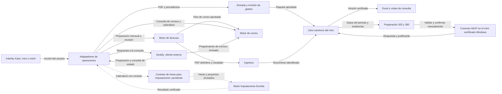

# Una plataforma para el mini y el móvil

Alcance acordado el 17/11/2026. El objetivo es gestionar facturas, correos,
contabilidad y modelos desde Kairo, y añadir después las horas y las imputaciones
de Excelia. La interfaz debe adaptar su distribución a la pantalla y ofrecer
las mismas operaciones en el mini y en el móvil.

**Gestify conserva su interfaz y queda fuera de esta unificación.** Es un cliente
externo que envía preparaciones y consulta el estado de sus correos y facturas
mediante el botón de sincronización que ya existe. La preparación y programación
de los correos se mantiene en Gestify; Kairo permite consultar su calendario y
estado. No se añade un editor paralelo de esos correos ni acciones de Kairo sobre
las jornadas o la configuración de Gestify.

Este documento fija el destino y las entregas pendientes. No acredita que todas
las integraciones estén instaladas. El estado de cada entrega debe actualizarse
cuando se haya comprobado su funcionamiento real.

## Una interfaz y una fuente por módulo

El mini y el móvil son dos accesos al mismo sistema. No deben mantener dos libros,
dos colas de gastos ni dos planes de envío que puedan modificarse por separado.
Cada módulo conserva su motor y su fuente de datos; la interfaz envía comandos
y presenta sus resultados, sin repetir los cálculos ni la lógica de aprobación.

| Módulo | Fuente que se conserva | Copias y salidas |
|---|---|---|
| Facturas y su correo | Servicio existente de Kairo, con sus preparaciones, versiones, aprobaciones y planes | PDF definitivo, estado de emisión y registro del correo |
| Correos de horas | Preparación/programación desde Gestify y servicio existente de horas | Kairo consulta el calendario y la última comprobación del estado de Outlook |
| Gastos | Bandeja de revisión existente de Kairo | Originales conservados en el mini y paquetes de incorporación aprobados |
| Contabilidad | Libro canónico del archivo `AUTONOMO` del mini | Excel, informes y copia de consulta con la misma versión verificada |
| Modelos | Preparación vinculada al libro; operaciones AEAT duraderas en el mini | Fichero, resultado de validación y justificante de aceptación, mediante certificado de Windows |
| Imputaciones Excelia | Motor del bot, calendario revisado y registros comprobados en Excelia | Plan, resultado de ejecución y exportación posterior verificada |
| Gestify, cliente externo | Conserva sus datos y su interfaz actuales, fuera de Kairo | Preparaciones enviadas a Kairo y respuesta a sus consultas de estado |

Excel es una salida del libro contable: modificar una copia descargada no cambia
el libro. La copia móvil debe mostrar su fecha y versión, y no aceptar cambios
como si fuera otra fuente independiente. Los repositorios de código no se
sincronizan por Drive o Syncthing.

## Módulos, entradas y salidas

Las conexiones discontinuas representan trabajo de integración pendiente. Cada
entrada debe conservar la identidad de la operación y la revisión que se aprobó.
Una respuesta perdida deja un resultado pendiente de comprobar; no autoriza
repetir una emisión, presentación o envío cuyo resultado sea incierto.
La respuesta a Gestify devuelve el estado que ha solicitado; no es una orden para
modificar su calendario, sus facturas ni su interfaz.

## Estado de partida

Ya existen el circuito de creación y gestión de facturas de Kairo, sus correos,
la programación de correos de horas y el bot de Imputaciones. Su existencia no
significa que todos sus controles estén integrados en la aplicación del mini.
El puente externo de Gestify se conserva. El calendario de Kairo es una vista de
consulta de los correos; su programación continúa en Gestify. La gestión de las
facturas mantiene las aprobaciones y condiciones de su motor existente.

La aplicación local permite consultar Resumen, Ingresos, Gastos, Libros y Modelos,
usar la bandeja compartida, aprobar incorporaciones y solicitar una actualización.
La recogida de Amazon está limitada al pedido configurado y a los PDF que lleguen
adjuntos al correo. El archivo de documentos para Renta existe; su cálculo completo
y las amortizaciones siguen pendientes.

Los modelos tienen preparación, controles, exportación y archivo de evidencias.
El [conector AEAT local](IVA-AEAT.md) añade validación, confirmación, envío y archivo
con el certificado del almacén de Windows. **Preparar o exportar un modelo no lo
presenta en Hacienda.** La presentación exige otra acción explícita sobre la versión
validada, con periodo terminado y configuración habilitada. Presentar, pagar y
conservar el justificante son estados distintos.

Se ha comprobado la validación oficial con datos sintéticos y del fichero histórico
303 2T 2026, sin errores y con aviso 31190; no se ha probado una presentación real
con este conector. La consulta autenticada del 303 3T 2026 se completó el 17/11/2026
a las 19:02:50 UTC: una declaración encontrada, ninguna nueva presentación. La
descarga directa de su justificante no está comprobada; `ConsultaExt` no facilita
una URL de descarga. El 4T real sigue abierto, con octubre únicamente, y el 390 requiere
el año completo y los cuatro 303. Estos datos no se presentan como parte de una prueba.

La [documentación oficial de servicios de declaraciones de AEAT](https://www.agenciatributaria.es/static_files/AEAT_Desarrolladores/EEDD/General/EspecificacionesServiciosDeclaracionesAEAT_ES.pdf)
incluye los modelos 303 y 390: `ServValiDos` para validación/impresión,
`PresBasicaDos` para presentación con certificado y conformidad, y `ConsultaExt`
para recuperar declaraciones. Son operaciones diferentes implementadas en `aeat_client`;
la pantalla y sus estados duraderos viven en el mini. Las comprobaciones pendientes
se conservan en la guía AEAT y no se sustituyen por el resultado de una prueba sintética.

## Entregas

1. **Facturas y Programación en el mini — en curso.** Llevar las operaciones
   existentes al mismo menú y mantener sus datos, estados y motores actuales.
   Integrar Facturas y el calendario de Programación reutilizando el circuito ya
   implantado. El calendario consulta los correos; prepararlos y programarlos
   sigue siendo una operación de Gestify. No crear otro emisor, programador de
   correos ni una interfaz alternativa de Gestify dentro de Kairo.
2. **Presentación de modelos — implementada en el mini; validación y consulta comprobadas.**
   Validar → revisar resumen → confirmar presentación → conservar respuesta y
   justificante. El certificado permanece en Windows; no se cambia VeriFactu.
   Existen validación oficial sintética, validación del fichero histórico 2T 2026 y
   consulta autenticada real del 3T. Queda completar el primer recorrido de presentación
   autorizado cuando haya un periodo listo y comprobar la descarga del justificante
   mediante una URL oficial disponible. Una prueba no habilita la etiqueta «Presentado».
3. **Paridad móvil — pendiente.** Servir la misma interfaz adaptable y las mismas
   operaciones mediante el acceso privado de Kairo. Comprobar desde el móvil
   consulta, creación, revisión, aprobación, descarga y recuperación tras una
   interrupción. No resolverlo manteniendo una segunda contabilidad en el teléfono.
4. **Horas e Imputaciones — integración futura separada.** Definir primero la
   consulta y el contrato de calendario que recibe el bot, y después conectar sus
   operaciones. Mantener la revisión del plan, la detección de cambios y la
   comprobación posterior en Excelia. No trasladar la interfaz de Gestify a Kairo
   ni condicionar su circuito de correos a completar este módulo.
5. **Ampliaciones documentales — pendientes.** Lectura avanzada de PDF/escaneados,
   más pedidos y proveedores, recopilación de Digi/luz/gas y cálculo completo de
   Renta. Son módulos independientes y no bloquean la integración de funciones
   que ya están operativas.

### Límite entre Gestify y Kairo

Gestify sigue preparando y programando los correos con los datos de sus jornadas,
y consulta después su estado mediante el botón de sincronización. Kairo muestra
el calendario y permite actualizar esa consulta a petición; no ofrece otro editor
para esos correos. El servicio conserva las operaciones ya aprobadas y su resultado.
No se añade una sincronización que escriba cambios de vuelta en Gestify.

### Contrato futuro de horas para Imputaciones

`horas-excelia` es el repositorio de Gestify; `imputaciones-bot` contiene el motor
Node/Edge que registra las imputaciones. El bot ya ofrece comparación e importación
de exportaciones de Gestify, preparación de un plan y verificación de Excelia.

El CSV actual contiene únicamente `Fecha,Estado`. El lector del bot asigna ocho
horas por día y obtiene los códigos de proyecto de su propia configuración. No
transmite las horas reales ni los códigos de proyecto guardados en Gestify.

La futura integración debe definir un contrato versionado, con fecha, estado,
duración, proyecto, procedencia y revisión. Debe conservar la compatibilidad con
el CSV anterior e identificar cuándo se aplica su equivalencia de ocho horas.
Una exportación de Gestify puede ser una entrada, igual que cualquier otra fuente
admitida explícitamente; no obliga a integrar su interfaz ni a centralizar sus
datos personales. Las importaciones deben presentar sus diferencias y conservar
su procedencia, sin fusionar automáticamente calendarios de distintos navegadores.

## Acciones y conectividad

Consultar o cambiar de sección no recoge correo, no escanea pedidos y no regenera
la contabilidad. Recoger, aprobar, actualizar o comprobar un estado son acciones
explícitas. Un correo programado conserva su ejecución en la fecha aprobada:
esa programación no exige vigilar periódicamente los gastos ni los modelos.

La consulta del archivo local del mini funciona con los datos disponibles aunque
Kairo no esté conectado. Las operaciones que viven en Kairo necesitan su servicio
y la conexión privada. La presentación AEAT usa el certificado de Windows y la
conexión a Internet del mini; además necesita recuperar la preparación vigente
de Kairo. No se trasladan las claves de VeriFactu para este circuito. Windows puede
solicitar permiso de uso de la clave; se mantiene esa protección. La adaptación
de ese conector al acceso móvil sigue pendiente. El motor de Imputaciones necesita
el mini encendido y una sesión válida de Excelia; en la futura integración, el
móvil podrá ordenar la operación, pero no sustituirá al proceso que la ejecuta.
Ninguno de estos botones debe depender de tener Codex
abierto. La futura paridad no implica que todas las acciones funcionen sin red.

## Cuándo se considera terminado

- Se puede completar cada recorrido autorizado desde la misma interfaz, con
  estados y operaciones equivalentes en mini y móvil, sin saltar entre paneles
  internos distintos. Una autenticación externa necesaria conserva su recorrido
  propio y devuelve el resultado a Kairo.
- Facturas, correos, gastos y modelos muestran la misma operación y revisión en
  ambos dispositivos. La repetición o pérdida de respuesta no genera duplicados.
- Gestify conserva su interfaz y el circuito de preparación/programación de
  correos; Kairo consulta sus estados. No se duplican editores ni se envían órdenes
  desde Kairo para modificar los datos de Gestify.
- Libro, Excel e índice de consulta coinciden en versión y huellas; los documentos
  originales siguen disponibles. Una publicación fallida conserva la última
  copia verificada, identificada con su fecha.
- «Presentado» requiere una aceptación real de AEAT y su justificante, asociados
  al modelo, periodo y versión enviados. La comprobación del pago es independiente.
- Horas e Imputaciones conservan el plan aprobado y el resultado comprobado en
  Excelia; una importación de calendario no se confunde con una imputación realizada.
- No se han añadido comprobaciones periódicas de contabilidad. Los errores indican
  qué operación quedó pendiente y permiten recuperarla sin empezar todo el circuito.

Las comprobaciones se acotan al módulo cambiado y a sus contratos afectados.
No es necesario repetir todo el historial de ensayos para entregar una mejora.

Referencias de implementación: [aplicación del mini](DESKTOP-ACCOUNTING.md),
[contabilidad modular](ACCOUNTING-MODULES.md) y
[preparaciones de Gestify hacia Kairo](KAIRO-DEVELOPMENT.md).
